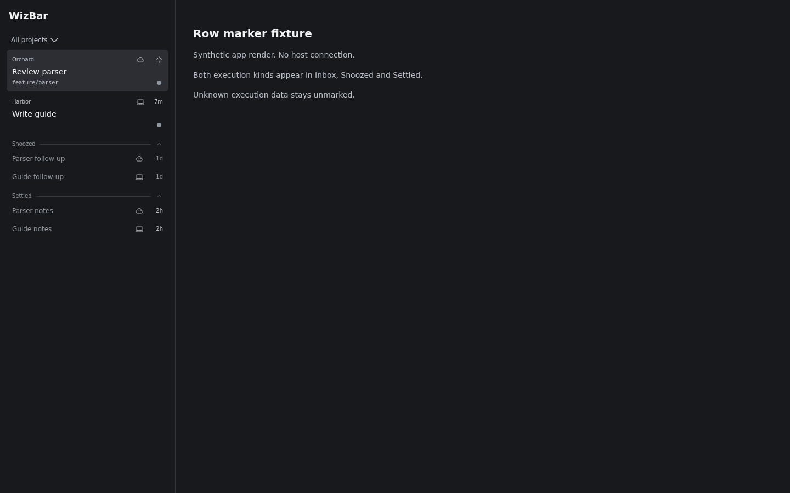

# WizBar

WizBar is the first plugin in WizPlugins: an OpenWiz sidebar for Cloudroom, in
`wizbar/`. It keeps Inbox, Snoozed and Settled shelves, manual parking and
parent/child header chips, adds Cloud/Local row markers and a batch lifecycle
command. Working or waiting threads cannot be parked; unreadable activity fails
closed. Parked threads return when work or new attention requires it.



Actual React UI rendered through the SDK fixture harness, with synthetic data and
styling; this is not an installed-app screenshot. Original targets and captures
remain in [WZ4 evidence](docs/evidence/wz4/visual-review.md) and
[WZ5 evidence](docs/evidence/wz5/verification.md).

**Current limits:** the production footer counter is blank: complete global
inputs and the in-thread subagent mapping are unverified. Spinner/number/hover
behavior is proved only on fixtures. Cloud/Local markers use the observed
`environment.providerId` mapping, not a documented SDK guarantee; unknown data
stays unmarked. The children header action has been observed in the host, but
WizBar's installed behavior remains unverified. PR badges appear inconsistently;
their reliability is a known unknown, so a missing badge alone is not a WizBar
regression.

## Install and activate — Unverified

Build, installation, co-installation with T3 Sidebar, activation and live command
execution remain **Unverified** pending the separately approved checks in [#9](https://github.com/openwizdev/wizplugins/issues/9).
The desktop CLI's help supplied these command forms; they are preparation, not
an installation receipt. Re-read the [install and rollback kit](https://github.com/openwizdev/wizplugins/issues/9#issuecomment-6768833446)
and current desktop help before choosing to run any step:

```sh
git clone https://github.com/openwizdev/wizplugins.git
cd wizplugins/wizbar
npm ci
room-cli plugin build .
room-cli plugin install .
room-cli plugin list
```

Record the current sidebar settings first. After installation, select WizBar in
**Settings → Appearance → Sidebar**, or use
`room-cli settings ui set sidebar.threadListProvider "<wizbar-plugin-id>"` with
its ID from `plugin list`. Change `sidebar.navigationProvider` only if T3 Sidebar
is selected there. Follow #9 for disabling T3 Sidebar and rollback; keep it
installed until replacement is accepted. WizBar uses its own store with no T3
import; separate runtime IDs/data are still unverified.

## Command

The registered namespace is `wizbar`; each operation takes one or many IDs:

```text
wizbar settle <id>... [--json]
wizbar unsettle <id>... [--json]
wizbar snooze <id>... --until <time> [--json]
wizbar unsnooze <id>... [--json]
wizbar list <id>... [--json]
```

`--until` accepts a future ISO timestamp with timezone, or the available sidebar
presets `hour`, `evening`, `tomorrow`, `next-week`. Results are per ID; one failure
does not suppress other IDs and gives a nonzero exit status. `list` reports the
resolved shelf and snooze wake time. Command and sidebar share the plugin store
and refresh channel; live dispatch and visible refresh remain unverified in #9.

## Credit and licence

WizBar starts from [Sawyer Hood’s T3 Sidebar](https://github.com/SawyerHood/sawyer-plugins/tree/d3424f24e2cebe91da4e72cb38feb023da808922/plugins/t3sidebar), copied unchanged from upstream commit `d3424f24e2cebe91da4e72cb38feb023da808922`. This repository starts with a fresh history; it does not import the upstream repository’s commits or other plugins.
Source path: `plugins/t3sidebar`; version tag: `t3sidebar/v0.1.0` (a different
commit from the copied snapshot above). WizBar changes follow that initial copy.

The root `LICENSE` retains Sawyer Hood’s upstream MIT notice. `wizbar/LICENSE` retains Michael Yong’s plugin MIT notice exactly. Both originals remain intact.

See the [public privacy and attribution audit](docs/verification/public-audit.md).
