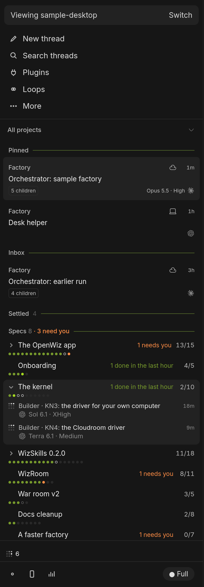

<picture>
  <source media="(prefers-color-scheme: dark)" srcset="https://raw.githubusercontent.com/openwizdev/.github/main/profile/art/wiz.png">
  
</picture>

# WizPlugins

**Cloudroom plugins for watching an [OpenWiz](https://github.com/openwizdev/OpenWiz) factory.** Optional: OpenWiz 0.1.0 needs no plugin, and these work only in Cloudroom.

**Status:** one plugin, [WizBar](wizbar/README.md). Version 0.7.0 is the release being prepared: the marketplace serves it once the `wizbar/v0.7.0` release tag exists and the registry's WizBar entry has the range `^0.7.0`. Until then it serves 0.6.0.

## Quick start

Install **WizBar** from the [BB Marketplace](https://getbb.app/marketplace/wizbar) in the BB app or Cloudroom, then pick it in **Settings → Appearance → Sidebar**.

From source: see the [WizBar README](wizbar/README.md).

## How it works

WizBar replaces Cloudroom's sidebar with three sections you can reorder: Pinned, Specs and Unread. Each thread is a card with its issue or pull request and its children. Specs shows one row per spec, what needs you first, each ticket a dot: done, building, in review, or needs you; the dot of a ticket whose agent is working breathes unless the ticket is done or in review, and finished or idle specs fold into a Quiet group. Open a spec to see its running builders and reviewers with their model and effort. Unread lists only threads with something new that are not working for a spec, and a "N running" line opens a steady card of the running threads. A small producer keeps the specs file fresh from GitHub. `room-cli wizbar` commands with JSON let agents settle, snooze, mute, pin and move threads, read the running card and the specs, open or close a spec and collapse a section; the sort picker, the section order, the Quiet group and opening the parked shelves have no command.

(The picture is the real UI rendered with made-up data.)

## Links

- [WizBar README](wizbar/README.md) · [BB Marketplace listing](https://getbb.app/marketplace/wizbar) · [marketplace entry](marketplace/wizbar.json)
- [OpenWiz](https://github.com/openwizdev/OpenWiz) · [openwiz.dev](https://openwiz.dev) · [all repos](https://github.com/openwizdev)

## Credit and licence

WizBar starts from [Sawyer Hood’s T3 Sidebar](https://github.com/SawyerHood/sawyer-plugins/tree/d3424f24e2cebe91da4e72cb38feb023da808922/plugins/t3sidebar), copied unchanged from upstream commit `d3424f24e2cebe91da4e72cb38feb023da808922`. This repository starts with a fresh history; it does not import the upstream repository’s commits or other plugins.
Source path: `plugins/t3sidebar`; version tag: `t3sidebar/v0.1.0` (a different
commit from the copied snapshot above). WizBar changes follow that initial copy.

New OpenWiz contributions are licensed under the Apache License, Version 2.0 (`LICENSE`). Parts derived from those upstream projects remain under the MIT License. Sawyer Hood’s original notice, copyright line and permission text, is in `THIRD_PARTY_LICENSES/LICENSE-MIT-sawyer-hood`. Michael Yong’s original plugin notice stays in `wizbar/LICENSE` and is also kept in `THIRD_PARTY_LICENSES/LICENSE-MIT-michael-yong`. See `NOTICE`.

See the [public privacy and attribution audit](docs/verification/public-audit.md).
