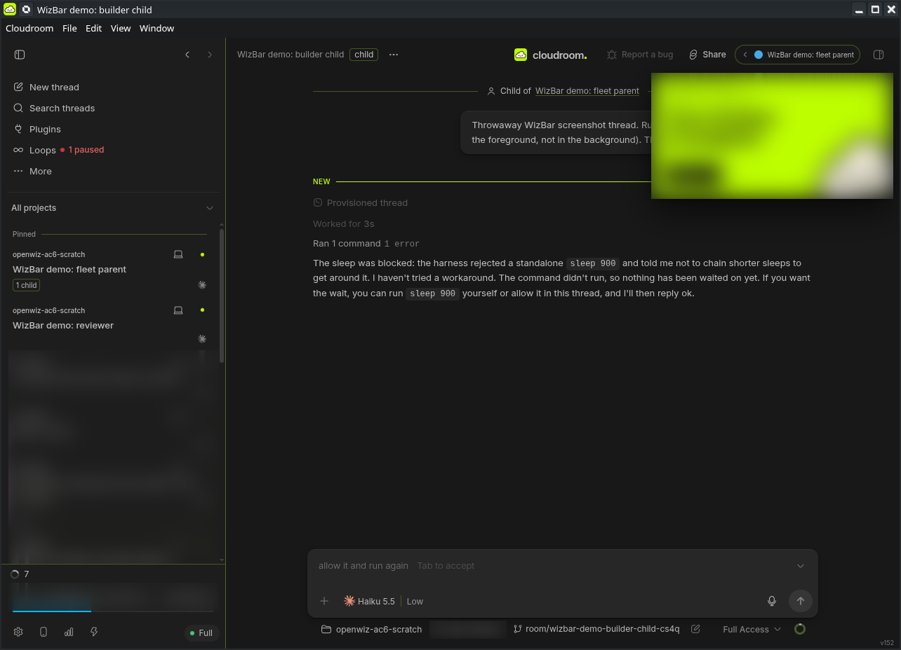
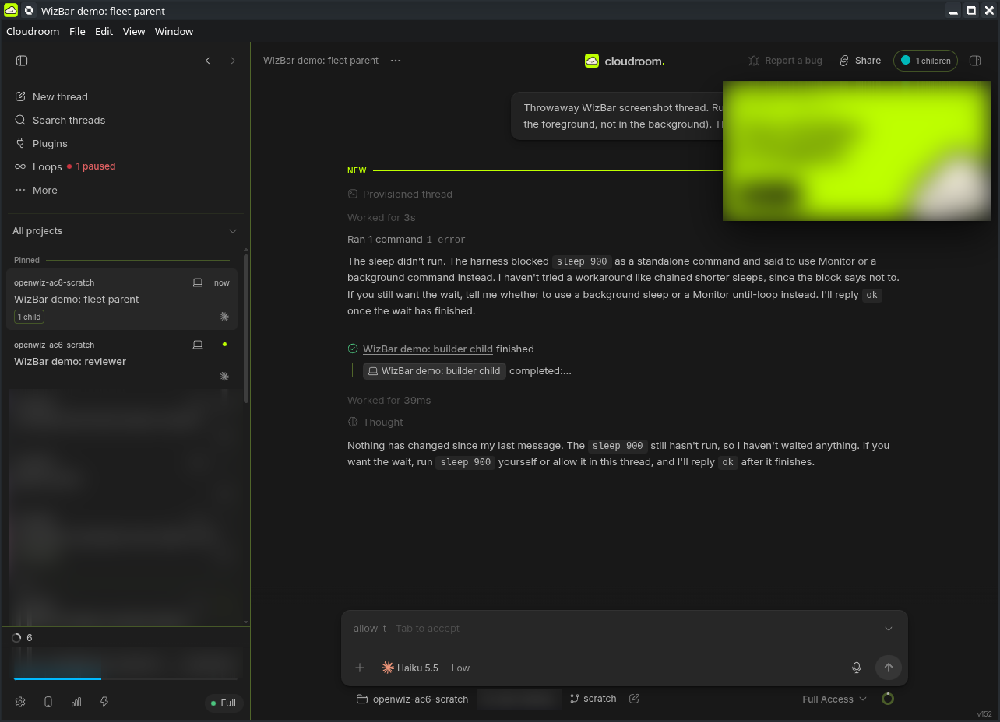

# WizBar v0.3 live check (WZ8, #9)

**Date:** 2026-11-13 (CLI part); visual part the same evening, after the owner approved screenshots (J10). **Who:** the owner's PC keeper ("pc hands"), on the owner's PC, under the existing keeper delegation. The owner judges acceptance.
**Evidence class:** real keeper observation on the PC. Items without a live result are marked **Gap** and stay Unverified; fixture and CI results are not counted here. Real ids, machine details and raw logs are in a private record, not here.

## Installed build

| Item | Value |
| --- | --- |
| Source commit | `404ffdcf662ee843ee35bb713d3b0c2912a7104c` (merge of #57, `main`) |
| Package | `bb-plugin-wizbar` **0.3.0** (`room-cli plugin list`: WizBar 0.3.0, running) |
| SDK | built against **0.6.51** (`dist/*.meta.json`: `sdkVersion` 0.6.51, `builtWith.pluginSdkVersion` 0.6.51, host bb 152); `package.json` pins `@get-bb/plugin-sdk` **0.6.33** for types |
| Install | `npm ci --ignore-scripts`, `room-cli plugin build .`, `room-cli plugin install . --yes` from a separate checkout of the commit. The previous local-path install stays on disk for a one-step rollback (`room-cli plugin install <previous path>`). T3 Sidebar stays installed and disabled; WizBar stays the sidebar provider |

Test threads: four throwaway Local threads in a scratch project (a parent, its child, and two idle threads), archived afterwards. Only these threads were pinned, moved or muted for this check; every change was undone before archiving.

## Results

| # | Criterion | Result | Evidence |
| --- | --- | --- | --- |
| 1 | Blockers merged; commit, package and SDK recorded | **Pass** | Table above; #39 to #44 merged (installed commit is #57's merge) |
| 2 | Cards: model/effort, issue/PR link, child count, branch on hover, normal and narrow | **Partial** | Seen on real and test rows: project line, title, machine icon, activity dot, age, and the child count (`1 child`, `19 children`; **absent at zero** on the test reviewer). Model and effort are **omitted with no placeholder** (the host exposes neither). **Gap:** the issue/PR link opening, branch on hover, and the narrow width need pointer input, which the keeper has no way to send to this Wayland desktop. |
| 3 | Children: hover panel, open child, open parent; chip defaults; each setting toggles its chip and persists after reload | **Partial** | Defaults seen: the child's header shows the `child` tag and the **parent chip** (‹ parent title), and the parent's header has no children chip. With `childrenChipEnabled` on, the parent's header shows the **children chip** (`1 children`); with `parentChipEnabled` off, the child's parent chip is gone (screenshots below; restored after). Settings persist across a plugin reload. CLI `children` lists the child. **Gap:** the hover panel and click-to-open (pointer input). Finding: the chip reads `1 children`; it should say `1 child`. |
| 4 | Count and stats match real running work incl. a child and a muted fleet thread; disclosures; live updates; dim zero | **Partial** | The **list-bottom line matched `stats --json` on two live reads** (8 = 3 top-level + 5 children; 7 = 3 + 4), and changed between reads with real work. Earlier, stats equalled an independent host count including a child and a muted test thread. Turning `footerCountEnabled` off removed the line. Disclosures are present in the JSON. **Gap:** the bolt's stats panel and dim zero (opening the panel needs a click). |
| 5 | Drag: pin, unpin and reorder; host pinned state agrees; Inbox order unchanged | **Partial** | Pin, move and unpin through the CLI showed up in the sidebar's Pinned section in the requested order, and the host's own pinned state agreed. **Gap:** dragging itself (pointer input). |
| 6 | CLI `pin`, `unpin`, `move`, `mute`, `children`, `stats` and existing commands with `--json`; stats JSON equals the panel | **Pass** (stats-equals-panel: Gap) | On throwaway threads, all with `--json`: `pin` (2 threads; the host showed both pinned), `move --before` (host pinned order B, A, matching `pinnedOrder`), `unpin` (the host showed not pinned), `mute`/`unmute` (shelf `muted`, then `active`; `list` read back `muted`), `children`, `stats`, `list`. Earlier keeper runs covered `settle`, `unsettle`, `snooze`; they were not repeated. Stats JSON equals the host's own count (row 4). Comparing it with the panel needs the screen. |
| 7 | Carried: settings-page persistence, Cloud/Local icons on known rows, footer item's real rendering | **Partial** | **Icons pass:** the laptop icon on known Local rows (the keeper's own thread and the test threads), the cloud icon on known Cloud rows (orchestrator and builders); turning `machineIconsEnabled` off removed them. **Footer seen:** a running line (spinner and number) at the list bottom, then settings, phone, stats and bolt buttons and the permission chip. Settings persist through the settings API and reload. **Gap:** the settings page UI itself (needs a click). |
| 8 | Privacy: ids, machine details, raw logs private; ≥ 2 sanitised screenshots ≥ 1200 px | **Pass** | Two screenshots, 1284 × 928, below. Real thread titles, the account balance, the machine name and an app pop-up are blurred; only throwaway demo threads are readable. No ids or raw logs here. |
| 9 | No publication, release or wider live authority | **Pass** | Nothing published or released; the PR adds this record only |

## Known unknowns carried

- A rarely shown PR badge alone is not a WizBar regression (owner note on #9).

## Screenshots

Captured on the owner's PC with the desktop's own screenshot tool and cropped to the app window. Throwaway demo threads only; everything else is blurred.

## Findings

- The children chip reads `1 children` for one child; it should say `1 child`.

## Still Unverified (pointer input)

The keeper can capture this Wayland desktop but can't send pointer input to the app, so these stay **Unverified**: the hover children panel and click-to-open, the issue/PR link opening, branch on hover, the narrow width, dragging, the bolt's stats panel and dim zero, and the settings page UI. The owner can check them by hand in a few minutes. They are the last open items of WZ8.
