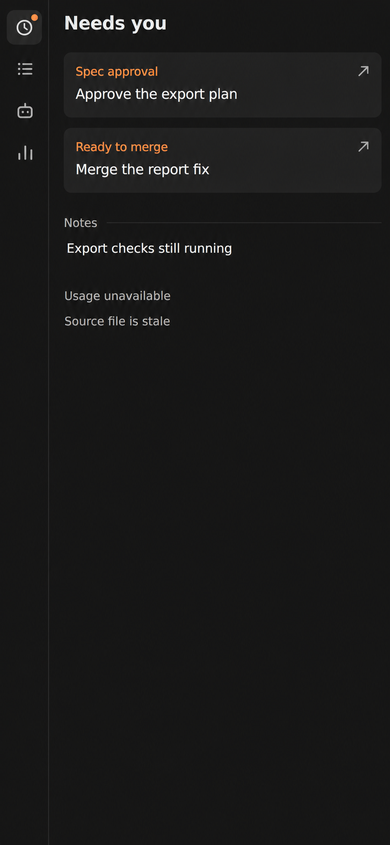
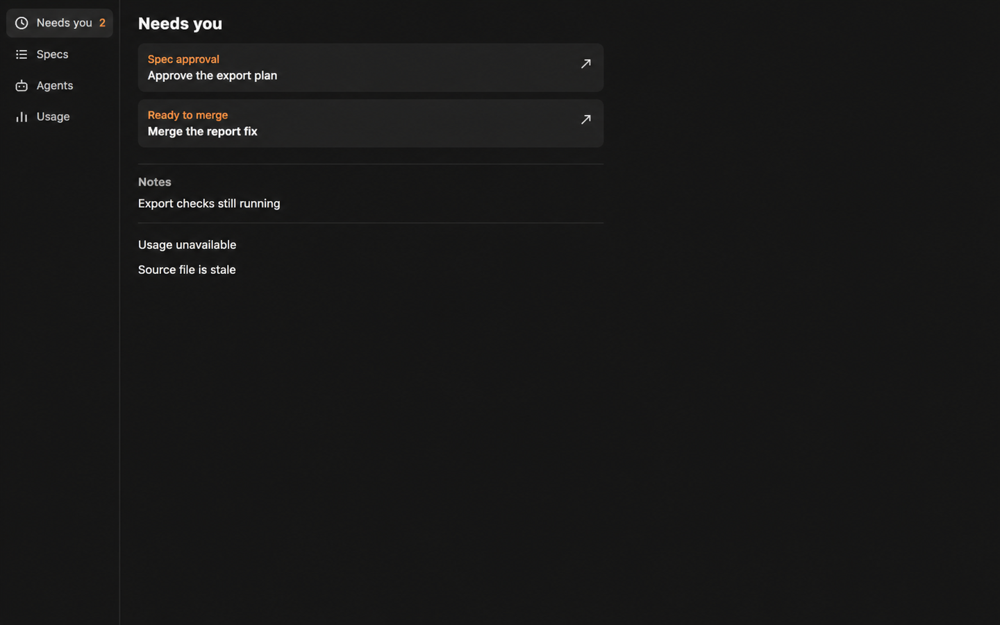

# Needs you visual targets

These generated designs show WizBar's dark Needs you board with synthetic data. [OpenWiz #3414](https://github.com/openwizdev/OpenWiz/issues/3414) supplies screenshots of the running board.

## 390 px

The compact rail shows icons for Needs you, Specs, Agents and Usage. The dot indicates that at least one card needs the owner. The 45 px prototype rail is the layout reference.

## 1440 px

The desktop rail labels all four views. Only the two open action cards contribute to the Needs you count. Both views put the approval and merge ahead of the scroll-only note. Usage is unavailable because its source file is stale, so it has no count. Agents is visible as a navigation item only.

Run `python3 -I docs/design/needs-you/verify.py` from the repository root to check the native widths. See the [brief](brief.md) and [generation prompts](prompts.md) for the content and prototype reference.
