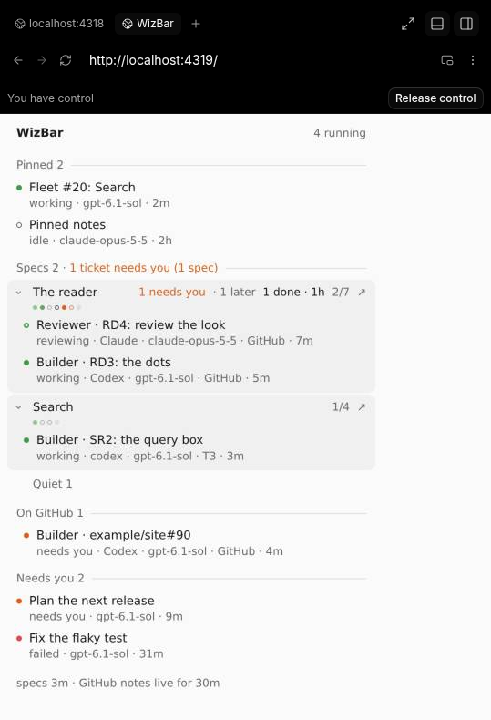

# WizBar for T3 Code

**Status: prototype, in a draft pull request.** It works with T3 Code as it ships today. It was checked live on T3 0.1.13 in its web client on Linux, not yet in the desktop app.

WizBar's fleet board inside [T3 Code](https://github.com/pingdotgg/t3code). It shows Pinned, Specs (one row per spec, each ticket a dot: done, building, in review, needs you) and Needs you, in T3's built-in browser panel. A small local server makes the page from the same files WizBar reads. Nothing in T3 changes.



(The picture is T3 Code's own browser panel showing this board, with made-up specs, notes and threads.)

## The design note

Jake asked for WizBar inside T3 Code now, and whether it can be an OpenWiz driver. There were three ways to get it. This section compares them and picks one.

### What T3 offers

Read from T3's source at commit `f7ec68be` (2026-11-27) and its user docs:

- **No plugin or sidebar extension point.** The thread sidebar (`apps/web/src/components/Sidebar.tsx`) is fixed code. The only "plugins" T3's docs mention are each agent's own plugins (Claude Code's or Cursor's).
- **A built-in browser panel** beside every thread, made for local dev servers. A project action (Settings → Projects → Actions, or `t3.json` `scripts`) can carry a **Preview URL** and **Open preview automatically when this action runs**. T3 also lists the ports a thread's terminals open under **Servers**, one click away.
- **A `t3 thread` command** on the host: `start`, `send`, `show` and `list`, each with `--json`. It signs in as a short-lived client of the running server and signs out when done, so no caller ever holds a key. It has no `stop`.
- **MCP tools** for agents and outside clients: thread list, launch, send, wait, interrupt, organize (pin, settle, archive) and rename, plus `delegate_task`, scheduled tasks, `html_render` and MCP Apps.

### The options

| | (a) An OpenWiz `t3` driver | (b) Port WizBar into T3's sidebar | (c) The board in T3's browser panel (**picked**) |
| --- | --- | --- | --- |
| What you get | Each fleet builder and reviewer is a T3 thread. T3's sidebar lists them by title and shows running or waiting. | WizBar's sections in T3's own left sidebar. | WizBar's board one click away in every thread's right panel, on web, desktop and (by T3's design) mobile. |
| Spec rows and ticket dots | No. T3's sidebar shows threads, not specs. A title can say `#12: the reader`, but it can't draw a spec's dots. | Yes. | Yes, with WizBar's rules and colours. |
| Changes to T3 | `t3 thread` has no `stop`, which driver v1 requires (D6). A driver can't call T3's MCP `t3_thread_interrupt` or archive without holding a session key (N2), so it needs an upstream `t3 thread stop`. | A large upstream patch: no extension point exists, and T3 asks every feature to cover web, desktop, mobile, every language and its performance budget. Until it merges, Jake runs a fork. | None. |
| Changes to OpenWiz | A new `adapters/t3/`, and the kit's five checks passed on a real T3 host with real agent runs. | None. | None. |
| Reuses WizBar | Only through the board in (c). | The rules, rewritten in T3's React and wire contracts. | The specs producer unchanged, its files, and its live-note rule (`wizbar/src/agents/format.ts`). |
| Time to a working view | Days, and blocked on T3 adding `stop`. | Weeks, and blocked on review upstream. | Today. This pull request. |

**Also looked at:**
- **A scheduled task that posts `html_render` snapshots** into a pinned thread. It shows on mobile, but every refresh is a paid agent turn. The board's `--once` flag prints exactly that page, for when you want a snapshot.
- **An MCP App.** T3 renders MCP Apps under a tool call in Codex and Claude threads. It could be interactive, but it needs its own MCP server, and it only appears when an agent calls the tool.

### The pick: (c), and why

(c) is the only option that gives Jake a WizBar-like view in T3 today without changing T3 or OpenWiz. The numbers match WizBar's, because it reads the same files from the same producer under the same rules. It was checked live: T3 ran the action, started the board and opened it in its browser panel by itself (see [What was checked](#what-was-checked)).

(a) is still worth doing later, if Jake wants fleets to run *in* T3. The board already matches T3 threads titled the way fleets title them (`#N: …`, `Review #P at <sha>`, `Fleet #S: …`). So a `t3` driver's builders would light up the board's dots with no further work. The blocker is one upstream command, `t3 thread stop`. (b) is the most work for the least gain over (c).

## Run it

You need Node 24, and WizPlugins cloned on the machine T3 runs on. The specs producer also needs a signed-in `gh` (see [its README](../wizbar/tools/specs-producer/README.md)).

**One click in T3 (recommended).** In T3, open a thread in your factory project → thread details → **Add project script** (or Settings → Projects → Actions), then:

- Name: `WizBar`
- Command: `node /path/to/WizPlugins/t3/board/server.ts --home /path/to/factory-home --repo owner/name --t3-project .`
- Preview URL: `http://localhost:4317`
- Turn on **Open preview automatically when this action runs**.

Run the action: the board opens in the browser panel. On the very first run, T3 can open the panel before the board is listening; press **Reload** once. Running the action again while the board runs just opens it again. You can give the action a keybinding.

**By hand.** Start the same command in any terminal, then open `http://localhost:4317` in T3's browser panel (right panel → **Browser**). On web, mobile or remote clients, the panel's tab runs in the T3 host's headless browser. A Linux host needs `t3 browser setup` once for that.

**A snapshot in a thread.** `node t3/board/server.ts --home … --once` prints one still page with no script. Ask an agent in T3 to show it with `html_render`, and it appears in the thread on every client, mobile included.

**Try it with made-up data:**

```sh
node t3/board/fixtures/synthetic.ts /tmp/wizbar-demo
node t3/board/server.ts --home /tmp/wizbar-demo --t3 t3/board/fixtures/fake-t3.mjs --t3-project demo
```

### Flags

| Flag | What it does |
| --- | --- |
| `--home <dir>` | Required. The factory home: the board reads `.openwiz/specs.v2.json`, `specs.v1.json` and `agents.v1.json` under it. |
| `--repo owner/name` | Repeatable. With at least one, the board runs WizBar's specs producer now and every `--every` minutes (default 10), never two at once. Without it, the board only reads the files, for example when a systemd timer already runs the producer. `--gh`, `--author` and `--run-map` pass through to the producer. |
| `--t3-project <path or id>` | Repeatable. Reads that T3 project's threads with `t3 thread list --project <p> --json` every `--t3-every` seconds (default 60). Without it, the T3 sections are off. `--t3 <path>` names the `t3` command (default `t3` on `PATH`). |
| `--port <n>` | Default 4317. The board listens on 127.0.0.1 only. |
| `--refresh <seconds>` | How often the open page refreshes itself (default 15). |
| `--once`, `--json` | Print one still page, or the board as JSON, and exit. |

## What it shows

- **Pinned**: T3 threads you pinned, not settled.
- **Specs**: WizBar's Specs section ([specs-section.v1](../wizbar/contracts/specs-section.v1.md)): `Specs N · M tickets need you (K specs)`, one row per spec with a ticket, needs you first, then unfinished, then finished, newest activity first. Each row has "K needs you", "N later", "N done · 1h", done/total and a link to the spec. Each ticket is a dot in WizBar's order and colours: done, done in the last hour, building, in review, needs you, later, held, not started. Finished specs, and specs with nothing moving for 3 days, fold into **Quiet**. A spec with running agents opens to list them. A ticket's dot breathes while a working builder names it, never while it is in review or done, and not under reduced motion.
- **Agents on a spec** come from two places, matched the way WizBar matches them:
  - live GitHub status notes from `agents.v1.json`: working or asking, less than 30 minutes old, matched by their exact ticket, or by a ticket's pull for a reviewer. These are fleet agents running anywhere, Cloudroom included.
  - T3 threads that are running, waiting on you or failed, titled `#N: …`, `Review #P at <sha>` or `Role · CODE: …`, or under a `Fleet #S: …` parent. A ticket number found in two specs matches neither: no guess.

  When a T3 thread and a GitHub note name the same ticket and role, the T3 thread shows once.
- **On GitHub**: live notes on tickets that are in no spec.
- **Needs you**: unpinned, unsettled, unsnoozed T3 threads that wait on your answer or failed. This stands in for WizBar's Unread: T3's thread list has no read state.
- **N running**: running T3 threads plus live working GitHub notes. It says "running unknown" when neither source can be read.

A missing, broken or stale file (older than 30 minutes) shows **Specs unavailable** with the reason, never zero. A failing `t3` shows **T3 threads unavailable** with its own first line.

## Safety

- It only reads. It never writes to GitHub or to T3, and it holds no login. The producer uses your `gh`, and the T3 read uses your `t3`. Each `t3 thread list` call is T3's own short-lived client session, opened and revoked by the `t3` command. You may see it briefly under Settings → Sharing & access.
- It listens on 127.0.0.1 and answers only requests addressed to `localhost`, `127.0.0.1` or `[::1]`. So another web page can't read it by pointing a name at this machine. GET only.
- Every value is escaped. Links leave the page only for `https://github.com/`. The page runs one inline script, allowed by a per-response nonce in its Content-Security-Policy, and makes no outside requests.

## What was checked

All of this ran on Linux with Node 24.22.1:

- **Tests:** `cd t3 && npm test` runs 20 tests on synthetic data: file rules, dots, sort and Quiet, note and title matching, T3 sections, escaping, and the real server process with a fake `t3` and a fake producer. `npm run typecheck` uses WizBar's locked TypeScript (`cd wizbar && npm ci` first). The `T3` workflow runs both on every pull request.
- **The real producer, unchanged:** the board ran WizBar's specs producer against the public `openwizdev/WizPlugins`, through `--repo`. It read the files the producer wrote: 3 specs, all finished or idle, so all in Quiet.
- **Live against T3 0.1.13** (`npx t3`, a throwaway data folder, a synthetic project):
  - `t3 thread list --json` printed the list items the board reads (`threadId`, `title`, `status`, `settled`, `snoozed`, `pinned`, `model`, `providerInstanceId`, `parentThreadId`, `updatedAt`). The board read them as ready.
  - With no T3 server running, the board showed `T3 threads unavailable: No running T3 Code server uses … Start T3 Code, then retry.`
  - In T3's web client, a `WizBar` project action with the Preview URL started the board in a T3 terminal and opened it in the browser panel. T3 listed the port under **Servers**. The first run needed one Reload. Running it again reused the running board.
  - That host blocks Chrome's sandbox, and `t3 browser setup` could not write the AppArmor profile there. The panel ran with T3's own `T3CODE_SERVER_BROWSER_SANDBOX=0` instead.

**Not checked:** the desktop app (Electron) and the mobile app; a factory with live agents (the live notes and T3 matching are covered by fixtures only).

## Limits

- It lives in the right panel of a thread, not in T3's left sidebar. T3 has no way to add to the sidebar.
- Rows don't open T3 threads. T3's thread links point at its hosted app, which would load inside the panel instead of switching the main view. Use T3's sidebar or `Cmd/Ctrl+K`.
- No settle, snooze, mute or pin buttons. Those stay in T3 (or `wizbar` in Cloudroom).
- Model names show as T3 and the notes give them (`gpt-6.1-sol`), not WizBar's friendly labels.
- The first run of the action can race the board's start; press Reload once.
