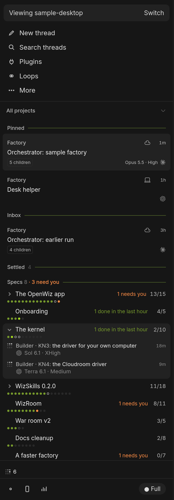

# WizBar

WizBar is an agent-first Cloudroom sidebar plugin for fleets of agent threads,
version 0.5.0. It keeps T3 Sidebar's flat list of cards, newest first, that
never re-orders itself, with Inbox, Snoozed, Settled, Muted and Pinned shelves.
v0.3 added richer cards, children on hover, a live running count, drag to pin,
and a `wizbar` CLI command with JSON for every sidebar action. v0.4 added a
Specs section under the list, matrix status marks and a quiet footer with a
hover card. v0.5 fills the Specs section with live data from a specs producer,
matches real fleet thread titles to their spec, shows friendly model and effort
labels, takes the confirmed 0.4 design, splits what needs you into due now and
later, and lets you collapse Pinned, Inbox and Specs. The project lives in
[openwizdev/WizPlugins](https://github.com/openwizdev/WizPlugins).



The image shows WizBar's real sidebar component and compiled styles in a
headless browser, with synthetic data and a copy of the host's chrome around
it, not an installed app. Everything below is proved by fixture tests in CI unless
it says otherwise. 0.5.0 was installed from source and run on a real Cloudroom
host for its live check; what that check did not cover is under Known limits. The rules and sources
are in the [v0.3 sidebar contract](contracts/sidebar-v3.v1.md) and the
[v0.4 specs section contract](contracts/specs-section.v1.md).

## What v0.5 shows

- **Specs.** Under the thread list, a rule such as
  `Specs 24 · 5 tickets need you (3 specs)`, or `Specs 24 · 5 for you` when the
  full sentence does not fit; it counts only tickets due now. Then one row per
  running spec from the bound factory's specs file. A row leads with a chevron
  when the spec has running agents, then its name; on the right, "K needs you",
  `· N later` and "N done in the last hour", then done/total. One dot per ticket
  sits on the line below: done, done in the last hour (a brighter done dot),
  building (a pulsing ring), review (a ring), needs you (solid warning), later
  (a hollow ring), held (a grey ring), not started. Finished specs are hidden. A
  missing, malformed or stale specs file shows "Specs unavailable", never zero
  (with two files, only when neither is ready; see the producer below).
- **Due now and later.** Only an open ticket labelled `ready-for-human` splits:
  due now (needs you) when it has no open blockers, later when it has open
  blockers. A blocked ticket in any other state keeps that state. Only due-now tickets count in
  the rule and in "K needs you"; later tickets show as hollow rings and
  `· N later`, and `wizbar specs` reports both.
- **Colours.** Done dots and the section rules use the host's success colour,
  or a neutral when the theme has none. "N done in the last hour" is the host's
  text colour. The warning colour marks needs you; a later ring is the warning
  hue at partial strength, never solid.
- **The specs producer.** Nothing in Cloudroom writes the specs file, so
  WizBar ships a small producer (`tools/specs-producer/`) that writes it from
  GitHub through your local `gh` login, REST only. It writes both
  `.openwiz/specs.v2.json` (with the later state) and `.openwiz/specs.v1.json`
  (as before, for an older WizBar), both or neither. WizBar uses the one that is
  ready when only one is; when both are ready, the newer `generatedAt` wins,
  v2 on a tie; when neither is ready, it shows "Specs unavailable". So the
  producer and WizBar can be upgraded in either order. `--gh`
  names the `gh` to run (default: `gh` on `PATH`). Each run is one complete
  scan, all or nothing: any failed read, or a scan needing more than 59
  requests, writes nothing and keeps the last files. Unchanged pages cost
  nothing against GitHub's rate limit, by ETag, and the run line reports how
  many requests came back 304 unchanged. Run it every 10 minutes as a systemd user timer; how to run
  it once, install the timer, remove it, and how many specs fit in 59 requests
  are in the [specs producer README](tools/specs-producer/README.md).
- **Host file reads.** WizBar reads the specs files and the factory's files
  from the host by absolute path: the bound factory's root joined with the
  file's relative path.
- **Collapsible sections.** Click the Pinned, Inbox or Specs header to collapse
  or expand it; every section starts expanded. The state is saved in the
  plugin setting `sectionsCollapsed`, so it is remembered. While a search is
  active, Pinned and Inbox show their matches even when collapsed, and their
  headers do nothing. `wizbar section` does the same from the CLI.
- **Open a spec.** Click a spec to open it in a raised panel with its running
  builders and reviewers; specs start collapsed and each one's open state is
  remembered. Real fleet titles match their spec: `#<N>: …` is ticket N's
  builder, `Review #<P> at <sha>` reviews the ticket whose pull request is P,
  and the children of `Fleet #<S>: …` belong to spec S (the fleet thread
  itself is not listed); the older `Role · CODE: …` form still matches. An
  agent row reads
  `Builder · EN3:` dimmed, then the task, then its age; its second line is the
  harness logo and the model and effort.
- **Model and effort** in friendly words: `Opus 5.5 · High`, `Sol 6.1 · XHigh`,
  from the host's resolved execution options for the thread, whatever source
  the host names for them. When the host answers with no options, the model
  comes from the thread's context snapshot and effort is left out. On cards
  they are quiet text. An unknown model is shown as it is; a missing one is omitted,
  never guessed. JSON keeps the raw ids and adds `modelLabel`.
- **Matrix marks.** A quiet 3 × 3 mark on each running agent row, the footer
  and its card: working is one light chasing round the ring, checks running
  pulses the middle row, reviewing lights the corners and centre, needs you is
  all warning, failed is a red X, done is all the done colour, idle is the
  centre only.
  No mark uses the accent colour. Reduced motion shows the still pattern.
  Thread cards show no mark.
- **Shelves.** Pinned, Inbox, Snoozed, Muted and Settled use the same done-colour
  rule as Specs. A parked shelf reads `Settled 4` with no chevron; a click
  still opens it. A running card shows its age (`now`) in the corner.
- **Footer.** No bolt: a matrix mark and `6 running`, counting threads, never
  subagents. Hover or focus it for a raised card across the sidebar: how many
  threads are waiting on you, the cloud and local split, a bar split by harness
  with each harness's name and count, then the running threads, one line each with its
  mark, role and code, its spec, and model · effort. A click (or Enter or
  Space) pins the card open and another unpins it; Escape closes it; clicking a
  thread in the card opens it.
- **GitHub** is a quiet hover mark that opens the spec issue or the agent's
  pull request.
- **Theme.** Every colour is a host theme variable, so WizBar follows the
  Cloudroom theme you use; a literal colour appears only as the fallback for a
  missing variable.
- **CLI.** `wizbar specs`, `wizbar spec <n> --open|--close`,
  `wizbar section <pinned|inbox|specs> --collapse|--expand`, the extended
  `wizbar stats` and the read-only `wizbar models <id>... [--raw]` return what
  the sidebar shows, as JSON with `--json`.

The matrix status idea is credited to Conductor's workspace status matrix
(Conductor changelog 0.85.0 to 0.96.0); idea only, no code or artwork.

## What v0.3 added

- **Cards.** The third line shows the issue or pull request as a link and a
  child count, hidden at zero. The pull request comes from the host's sidebar
  state. With no host issue field, the issue number is parsed from a
  `room/<N>-…` branch name and shown only when it parses. The branch shows on
  hover only. Model and effort are omitted until the host exposes them; nothing
  is shown in their place. Cloud rows currently carry no branch or pull request
  in the observed host data, so they show no link.
- **Children.** Hover or focus the child count to list the children with
  status, title and age, in spawn order; click one to open it, or open the
  parent. In the thread header, the parent's children chip is off by default
  and a child's chip back to its parent is on by default; each has a setting.
- **Running count.** A slim "N running" line stays below the list. A thread is
  running when it has runtime work and is not waiting on you. (v0.3's footer
  bolt and stats panel became v0.4's hover card above.)
- **Drag to pin.** Drag a card into Pinned to pin it, out to unpin it, or
  inside Pinned to reorder it; Alt+Up and Alt+Down do the same from the
  keyboard. WizBar uses the host's own pins and pinned order. The Inbox stays
  newest-first.
- **Settings.** Switches for the list-bottom count, Cloud/Local row icons and
  the two header chips.

## Install

**From the BB Marketplace:** 0.5.0 is the release being prepared. The
marketplace serves it only once both hold: the `wizbar/v0.5.0` release tag
exists, and the registry's WizBar entry has the range `^0.5.0` (this
repository's [marketplace entry](../marketplace/wizbar.json) has it). Until
both, the listing serves 0.3.0.

**From source.** These steps were run for 0.5.0 on a real Cloudroom host for
its live check: build, install, reload, and an upgrade from 0.3.0 that kept
WizBar's settings. `room-cli plugin build .` builds the plugin into `dist/`.
To fill the Specs section, also set up the
[specs producer](tools/specs-producer/README.md). The
desktop CLI's help supplies these preparation commands. Read the
[install and rollback kit](https://github.com/openwizdev/WizPlugins/issues/9#issuecomment-6768833446)
and current desktop help before running them.

```sh
git clone https://github.com/openwizdev/WizPlugins.git
cd WizPlugins/wizbar
npm ci
room-cli plugin build .
room-cli plugin install .
room-cli plugin list
```

Record the current sidebar settings first. Select WizBar in
**Settings → Appearance → Sidebar**, or use
`room-cli settings ui set sidebar.threadListProvider "<wizbar-plugin-id>"`
with its ID from `plugin list`. Change `sidebar.navigationProvider` only if
T3 Sidebar is selected there. Keep T3 Sidebar installed until replacement is
accepted. Follow #9 for disabling it and rollback. WizBar imports no T3 parked
rows. Separate runtime IDs and data still need live verification.

## CLI

The registered namespace is `wizbar` (`room-cli wizbar …`). Every WizBar
action in the sidebar has a command, and every command takes `--json`; the
[parity test](src/cli-parity.test.ts) checks both, and that `children` and
`stats` JSON equal what the hover list and the running line's hover card show
for the same threads. The row menu's host-owned items are excluded by name (below). Use `--`
to end options before literal IDs.

```text
wizbar settle <id>... [--json]
wizbar unsettle <id>... [--json]
wizbar snooze <id>... --until <time> [--json]
wizbar unsnooze <id>... [--json]
wizbar mute <id>... [--json]
wizbar unmute <id>... [--json]
wizbar list <id>... [--json]
wizbar pin <id>... [--json]
wizbar unpin <id>... [--json]
wizbar move <id> (--before <id> | --after <id> | --first | --last) [--json]
wizbar children <id> [--json]
wizbar stats [--json]
wizbar specs [--json]
wizbar spec <n> (--open | --close) [--json]
wizbar section <pinned|inbox|specs> (--collapse | --expand) [--json]
wizbar models <id>... [--raw] [--json]
```

**Exit codes**, every command: `0` success; `1` any thread or the whole command
failed; `2` usage error. The exception is `models`: a failed host read gives
that thread a null model and effort with exit `0`, so check the returned
fields, or the per-thread error status with `--raw`. A usage error with `--json` prints
`{"error":{"code":"usage","message":"<usage>"}}`.

**Per-ID commands** (`settle` to `unpin`) handle each ID on its own: one
failure never hides the others, and gives exit 1.

- `settle`, `unsettle`, `snooze`, `unsnooze`, `mute`, `unmute` and `list`
  print `{"results":[{"threadId","ok":true,"shelf","snoozedUntil"}]}`; a
  failed ID is `{"threadId","ok":false,"error":{"code","message"}}`. `list`
  reports the resolved shelf and snooze wake time.
- Only `snooze` takes `--until`: a future ISO timestamp with a timezone, or a
  sidebar preset `hour`, `evening`, `tomorrow` or `next-week`.
- `mute` is the running-thread exception for keeper-selected fleet work: it
  needs a running, unpinned thread with no pending input or failure. A
  question, failure or stopped work with newer unread attention returns the
  thread to the Inbox; `unmute` undoes it. See the
  [mute contract](contracts/mute.v1.md).
- `pin` and `unpin` print `{"results":[{"threadId","ok":true,"pinned":true}]}`.
  Pinning a pinned thread, or unpinning an unpinned one, succeeds and changes
  nothing.

**`move`** takes one pinned thread and one position and prints
`{"results":[{"threadId","ok":true,"pinned":true,"pinnedOrder":[…]}]}`, the
pinned order read after the move. Its errors include `not_pinned` and
`invalid_anchor`.

**`children <id>`** prints the thread's children, oldest first:

```json
{"parentThreadId":"thr_example_p","children":[{"id":"thr_example_c","status":"working","title":"Example child","model":null,"effort":null,"updatedAt":1794484800000}]}
```

Status is the first of `waiting`, `failed`, `working`, `unread`, `idle` that
holds. An unknown ID prints `{"error":{"code":"unknown_id",…}}` with exit 1.

**`stats`** prints the hover card's data: 0.3's numbers at `version: 2`, plus
the harness split and every running thread with its matrix state, visible spec
and model and effort (null when the host gives none):

```json
{"version":2,"status":"ready","running":{"total":2,"topLevel":0,"children":2,"cloud":2,"local":0,"unknown":0},"waitingOnYou":1,"finishedToday":{"source":"none","count":null},"window":{"timeZone":"UTC","start":1795046400000,"end":1795132800000},"coverage":{"scope":"observable-sidebar","subagents":"not-counted","unseen":"possible"},"harness":[{"providerId":"sample-harness","count":2}],"threads":[{"id":"thr_v4_example","title":"Builder · SP-2: Example work","providerId":"sample-harness","matrix":"working","spec":"example/sample-plans#501","shortName":"Example spec","model":null,"effort":null}]}
```

`window` is today in the server's time zone. A thread names a spec only when
the specs file is ready and the spec is visible. Unreadable thread state prints
`{"error":{"code":"state_unavailable",…}}` with exit 1, never a guessed number.

**`specs`** prints the visible spec rows with their running agents, and
**`spec`** opens or closes one spec in the section; an unavailable specs file
prints `{"error":{"code":"specs_unavailable",…,"reason":…}}` with exit 1.

**`section`** collapses or expands one sidebar section, the same as a click
on its header, and prints `{"section":"inbox","collapsed":true}`. A failed
settings read or write prints `{"error":{"code":"settings_failed",…}}` with
exit 1 and writes nothing from a failed read.

**`models`** is read-only: each thread's model and effort as WizBar reads
them, `{"models":[{"threadId","model","effort","modelLabel"}]}`, `modelLabel`
only when there is a model. With `--raw`
each item adds the host's raw answer and any context fallback model.

The values above are examples. The full JSON shapes and error codes are in
[section 7 of the v0.3 contract](contracts/sidebar-v3.v1.md#7-cli) and
[section 8 of the v0.4 contract](contracts/specs-section.v1.md#8-cli). Live dispatch,
and the CLI matching the hover card on a real host, await #9.

### Host-owned row-menu items

The right-click menu's Pin and Unpin are `wizbar pin` and `wizbar unpin`. Its
other items call the host's own thread actions, not WizBar's, so they have no
`wizbar` command. The parity test lists each by name, and fails on any menu
item that is neither a command nor listed here.

| Menu item | Agent route |
| --- | --- |
| Archive | `room-cli thread archive`, the host's own command. The help read for this change shows only `--self`; archiving another thread by ID is unverified |
| Mark read / Mark unread | **Gap:** no read-state route ([#60](https://github.com/openwizdev/WizPlugins/issues/60), v0.4). For attention, `wizbar settle` and `wizbar mute` move a thread off the Inbox; neither changes the host's read state |
| Open in split | None: UI-only host navigation |
| Delete | None: UI-only, and it keeps the host's confirmation |

## Known limits

- A finish time and an issue field are not exposed by the host yet; WizBar
  omits or discloses them.
- Subagents are not counted; threads the sidebar does not see may be missing.
- Cloud rows carry no branch or pull request in observed host data.
- The real pinned order, footer placement, the hover card's real look and
  rollback to T3 Sidebar are unverified until #9. PR badges have appeared inconsistently on real hosts; a
  missing badge alone is not a WizBar regression.

## Credit and licence

Derived from Sawyer Hood's T3 Sidebar, copied from `plugins/t3sidebar` at commit
`d3424f24e2cebe91da4e72cb38feb023da808922`. The source tag is
`t3sidebar/v0.1.0` (a different commit from that copied snapshot). WizBar starts
with a fresh history and adds its own changes after the copy.
[Upstream source](https://github.com/SawyerHood/sawyer-plugins/tree/d3424f24e2cebe91da4e72cb38feb023da808922/plugins/t3sidebar).

The MIT licences retain Sawyer Hood's original notice at the repository root
and Michael Yong's original plugin notice in this folder. The root licence adds
the WizBar notice. See the [root LICENSE](../LICENSE), [plugin LICENSE](LICENSE)
and [public privacy and attribution audit](../docs/verification/public-audit.md).
