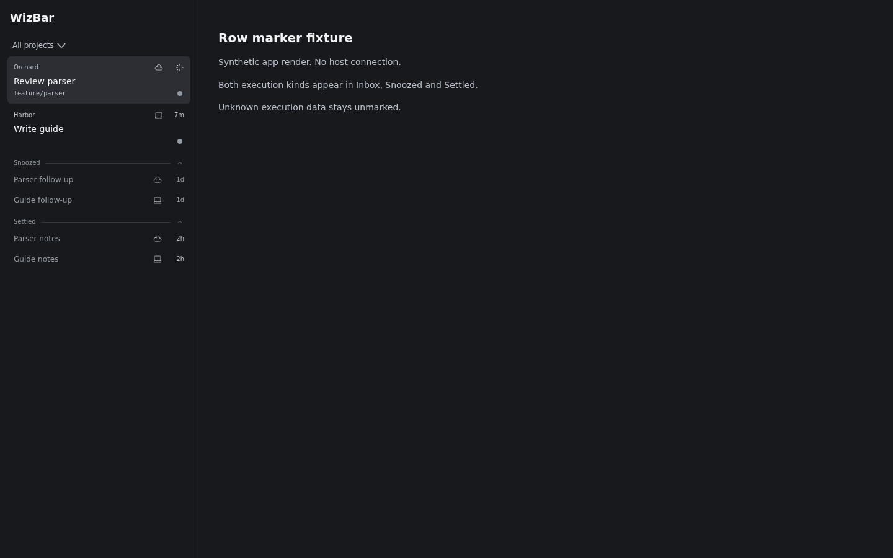

# WizBar

WizBar is the Cloudroom sidebar plugin in
[openwizdev/wizplugins](https://github.com/openwizdev/wizplugins). It keeps
T3 Sidebar's Inbox, Snoozed and Settled shelves, manual parking and parent/child
header chips, and adds batch lifecycle commands and Cloud/Local row markers.
Working or waiting threads cannot currently be parked; unreadable activity fails
closed. Parked threads return when work or new attention requires it.



This is the actual React UI with synthetic fixture data and styling, not an
installed-app screenshot. The production footer counter is blank. Current row
markers use an observed `environment.providerId` mapping with unknown data left
unmarked; correct live Cloud classification remains pending. Settings switches,
explicit running-fleet mute and a real running-thread footer count are planned
in [#25](https://github.com/openwizdev/wizplugins/issues/25),
[#26](https://github.com/openwizdev/wizplugins/issues/26),
[#28](https://github.com/openwizdev/wizplugins/issues/28) and
[#29](https://github.com/openwizdev/wizplugins/issues/29).

## Install and activate — Unverified

Build, installation beside T3 Sidebar, activation and live command execution
remain **Unverified** pending [#9](https://github.com/openwizdev/wizplugins/issues/9).
The desktop CLI's help supplies these preparation commands. Read the
[install and rollback kit](https://github.com/openwizdev/wizplugins/issues/9#issuecomment-6768833446)
and current desktop help before running them:

```sh
git clone https://github.com/openwizdev/wizplugins.git
cd wizplugins/wizbar
npm ci
room-cli plugin build .
room-cli plugin install .
room-cli plugin list
```

Record the current sidebar settings first. Select WizBar in
**Settings → Appearance → Sidebar**, or use
`room-cli settings ui set sidebar.threadListProvider "<wizbar-plugin-id>"`
with its ID from `plugin list`. Change `sidebar.navigationProvider` only if
T3 Sidebar is selected there. Keep T3 Sidebar installed until replacement is
accepted; follow #9 for disabling it and rollback. WizBar imports no T3 parked
rows; separate runtime IDs and data still need live verification.

## Commands

The registered namespace is `wizbar`. Each operation accepts one or many IDs:

```text
wizbar settle <id>... [--json]
wizbar unsettle <id>... [--json]
wizbar snooze <id>... --until <time> [--json]
wizbar unsnooze <id>... [--json]
wizbar list <id>... [--json]
```

`--until` takes a future ISO timestamp with a timezone, or an available sidebar
preset: `hour`, `evening`, `tomorrow`, `next-week`. Results are per ID; one failure
does not suppress other results and produces a nonzero exit status. `list`
reports the resolved shelf and snooze wake time. Commands and sidebar share the
plugin store and refresh channel; live dispatch and visible refresh remain
unverified in #9.

## Credit and licence

Derived from [Sawyer Hood's T3 Sidebar](https://github.com/SawyerHood/sawyer-plugins/tree/d3424f24e2cebe91da4e72cb38feb023da808922/plugins/t3sidebar),
copied from `plugins/t3sidebar` at commit
`d3424f24e2cebe91da4e72cb38feb023da808922`. The source tag is
`t3sidebar/v0.1.0` (a different commit from that copied snapshot). WizBar starts
with a fresh history and adds its own changes after the copy.

MIT: the [root LICENSE](../LICENSE) retains Sawyer Hood's original notice and
adds the WizBar notice; [wizbar/LICENSE](LICENSE) retains Michael Yong's original
plugin notice. Both original notices remain intact. See the
[public privacy and attribution audit](../docs/verification/public-audit.md).
